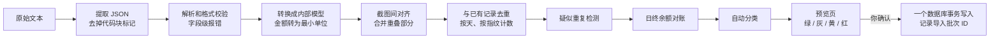

# 02 技术方案

## 1. 技术栈

| 层 | 选型 | 理由 |
|---|---|---|
| 语言 | Kotlin | 和 Java 能互相调用，学习成本低；英国安卓岗位的主流语言 |
| 跨平台 | Kotlin Multiplatform（目标平台：Android 和 JVM 桌面） | 核心引擎只写一次，两个平台的行为完全一致 |
| 界面 | Compose Multiplatform + Material 3 | 安卓和桌面端共用界面代码 |
| 本地数据库 | SQLite + **SQLDelight** | 直接写 SQL，自动生成类型安全的代码；对账和统计查询写起来直观 |
| 序列化 | kotlinx.serialization | 支持 KMP；可以开启严格模式，遇到未知字段直接报错 |
| 日期 | kotlinx-datetime | KMP 标准的日期库 |
| 依赖注入 | Koin | 支持 KMP，比 Hilt 轻量 |
| 页面状态和导航 | JetBrains 发布的多平台版 lifecycle-viewmodel 和 navigation-compose | 写法和安卓官方一致（版本见下面的 1.1 节） |
| 图表 | 先用 Compose Canvas 自己画（环形图、柱状图） | 我不确定目前有没有成熟、同时支持安卓和桌面的图表库，M4 开始前再调研；需要的图表很简单，自己画工作量可控 |
| 加密 | 标准库 `javax.crypto`（AES-GCM、PBKDF2） | 安卓和桌面端都跑在 JVM 上，可以共用一份实现 |
| 构建 | Gradle（Kotlin DSL）+ version catalog | |
| 测试 | kotlin.test；在 CI 里用 JVM 上的 JSON Schema 校验器检查示例文件 | |
| 代码质量 | ktlint、detekt、gitleaks | |
| 打包 | 安卓 APK；Windows 用 Compose 自带的打包工具生成 MSI | |
| **第二阶段后端** | Java 21 + Spring Boot 3 + PostgreSQL | 你最擅长的技术栈，也是英国后端岗位的主流 |

### 1.1 版本基线（2026-10-18 核实）

所有版本集中在 `gradle/libs.versions.toml`。规则：只用稳定版，并且发布满两周。

| 组件 | 版本 | 备注 |
|---|---|---|
| Kotlin | 2.4.20 | 官方测试过的范围：Gradle ≤ 9.7、AGP ≤ 9.3.x |
| Gradle | 9.7.1 | Wrapper 带 SHA-256 校验 |
| Android Gradle Plugin | 9.3.3 | 没选 9.4：超出 Kotlin 2.4.20 测试过的范围 |
| Compose Multiplatform | 1.12.1 | 要求 Android **compileSdk ≥ 37** |
| Material 3（Compose MP） | 1.9.0 | 从 Compose MP 1.9 起单独发版，这是最新的稳定版 |
| SQLDelight | 2.4.0 | 2.4.1 发布不满两周 |
| Koin | 4.2.2 | |
| kotlinx-serialization / datetime / coroutines | 1.11.0 / 0.8.0 / 1.11.0 | |
| lifecycle-viewmodel / navigation-compose（JetBrains 多平台版） | 2.11.0 / 2.9.2 | |
| ktlint / detekt / Kover | 1.8.0 / 1.23.8 / 0.9.11 | detekt 1.23.8 在 Kotlin 2.4 下实测可用（不做类型解析） |
| gitleaks | 8.30.1 | 本地 pre-commit 和 CI 用同一个版本 |

Android：`compileSdk = 37`、`targetSdk = 36`、`minSdk = 26`。JDK 21 编译，字节码目标 17。

**AGP 9 带来的结构变化**：KMP 模块里的 Android 目标改用 `com.android.kotlin.multiplatform.library` 插件，不能再在同一个模块里打 APK，所以 APK 只在独立的 `androidApp` 模块里生成（这正好符合第 2 节的模块划分）。AGP 9 自己编译 Kotlin，`androidApp` 不再需要 `kotlin-android` 插件。

`core` 只有 JVM 一个编译目标（安卓也跑 JVM 字节码，可以直接依赖），这样从构建配置上就保证了它不会引入任何 Android API。

## 2. 整体架构

```mermaid
flowchart TB
    subgraph External["App 外（你手动操作）"]
        SS[iPhone 截图] --> AI[ChatGPT / Claude<br/>项目里设好了提示词]
        AI --> JSON[导入格式 v1 的 JSON]
    end

    subgraph App["SnapLedger（Kotlin Multiplatform）"]
        subgraph Platform["平台层"]
            AND[androidApp<br/>分享菜单 · 指纹解锁 · 剪贴板]
            DESK[desktopApp<br/>Windows 打包 · 剪贴板 · 文件选择]
        end
        subgraph UI["ui 模块（Compose Multiplatform）"]
            SCR[页面：概览 · 流水 · 统计 · 设置 · 导入预览]
            VM[ViewModels]
        end
        subgraph Core["core 模块（纯 Kotlin，不依赖其他模块）"]
            PARSE[解析和格式校验]
            ALIGN[截图间对齐]
            DEDUP[与已有记录去重]
            RECON[日终余额对账]
            CLS[自动分类引擎]
            MONEY[金额和币种]
        end
        subgraph Data["data 模块"]
            REPO[Repositories]
            SQL[(SQLite<br/>SQLDelight)]
            BAK[加密备份的导出和导入]
        end
        AND --> SCR
        DESK --> SCR
        SCR --> VM --> Core
        VM --> REPO
        Core -.依赖接口.-> REPO
        REPO --> SQL
        BAK --> SQL
    end

    JSON -->|粘贴、剪贴板或分享| AND
    JSON -->|粘贴或剪贴板| DESK

    subgraph Future["第二阶段"]
        SRV[Java + Spring Boot 同步服务] --- PG[(PostgreSQL)]
    end
    REPO -. v2.0 同步 .-> SRV
```

### Gradle 模块

```
snapledger/
├── core/          # KMP：领域模型和引擎，纯 Kotlin，没有任何 UI 或数据库依赖
├── data/          # KMP：SQLDelight 的表结构和查询、Repository 实现、加密备份
├── ui/            # KMP：Compose Multiplatform 的页面、ViewModel、多语言资源
├── androidApp/    # 安卓入口：Manifest、分享菜单的 Intent、BiometricPrompt
├── desktopApp/    # Windows 入口：main 函数、打包配置
├── server/        # 第二阶段：Java + Spring Boot（独立的 Gradle 构建）
├── docs/          # 需求文档、ADR、数据格式规范、提示词模板
│   └── adr/
├── schemas/       # import-v1.schema.json
└── samples/       # 虚构的示例 JSON（测试也会用到）
```

**依赖方向**：`ui → core ← data`。`core` 里只定义 Repository 接口，`data` 负责实现。所以引擎可以完全脱离数据库和界面，单独做单元测试。

## 3. 导入流水线



每一步都是一个纯函数：输入一批数据，输出一批数据和一组诊断信息。所以每一步都可以单独测试。

## 4. 关键算法

### 4.1 指纹

```
normalize(s) = s 转大写 → 去掉字母、数字、空格以外的字符 → 连续空格合并为一个 → 去掉首尾空格
fingerprint  = (账户, 日期, 方向, 金额最小单位, 币种, normalize(原始描述))
```

用**原始描述**而不是 AI 规范化后的商户名，因为原始描述是 AI 照抄的，比 AI 推断出来的商户名更稳定。

### 4.2 截图间对齐（解决同一批截图的重叠）

同一批里有截图 S1、S2……Sn（按你发送的顺序）。汇丰的列表是新的在上面，往下滑看到更早的交易，所以通常 S1 在上、S2 在下。

```
merged = S1
对每个 Si（i ≥ 2）：
    k = 最大的 k，使得 merged 的最后 k 条和 Si 的前 k 条指纹逐条相同
    如果 k > 0：把 Si 的第 k+1 条及以后的记录接到 merged 后面
    否则，反过来再找一次（Si 的最后 k 条 = merged 的前 k 条），兼容截图发送顺序颠倒的情况
    如果两个方向都没有重叠：直接拼接；Si 里和 merged 指纹相同的记录标为"疑似重复（截图间）"
```

**为什么同一天买两次 £3.50 的咖啡不会被误删**：对齐比较的是**一段连续的序列**，不是单条记录。两杯咖啡在两张截图里都完整出现，对齐后只会去掉重叠的那一段，两杯咖啡都会保留。示例数据 `example-2-overlap.json` 演示的就是这个场景。

**指纹的日期为 null 时**：截图顶部的分组标题被切掉了，日期不确定。对齐时只比较其他字段，对齐成功后从前一张截图继承日期。

### 4.3 与已有记录去重（解决跨批次重复）

对齐之后，对本批出现的每个日期 d、每个指纹 f：

```
m = 本批中 (d, f) 的记录条数
n = 数据库中 (d, f) 的有效记录条数（导入的记录）
自动跳过 min(m, n) 条，导入 max(0, m − n) 条
```

用计数而不是"存在就跳过"，可以正确处理两种情况：
- **上次的截图截在一天的中间**：数据库里这一天只有一部分记录（n 小），这次截全了（m 大），只补导缺的那几条。
- **同一天有两笔完全相同的消费**：数据库里有 2 条，本批也是 2 条，全部跳过；本批是 3 条，导入 1 条。

被跳过的记录在预览页的"已跳过"分组里列出，可以撤销。

### 4.4 疑似重复

对准备导入的新记录，如果数据库里**同一天前后 1 天内**有方向和金额都相同、但描述不同的记录，就标黄。这种情况通常是 AI 两次抄写的描述不一样（比如 `MARKS&SPENCER` 和 `MARKS & SPENCER`）。

**默认导入还是跳过，由对账结果决定**：如果加上这笔当天才对得平，默认导入；如果去掉这笔才对得平，默认跳过；如果判断不了，默认导入，等你决定。

### 4.5 日终余额对账

汇丰每个日期分组的标题上显示的是当天的日终余额。设这个日期是 d，余额是 B(d)：

```
p = d 之前最近一个有余额记录的日期（在本批或数据库中）
期望 = B(p) + Σ(p < 日期 ≤ d 的收入) − Σ(p < 日期 ≤ d 的支出)
如果 期望 == B(d)：这一天"已对平"
否则："不平"，差额 = B(d) − 期望
如果找不到 p："无法校验"（比如第一次导入）
```

- 差额会显示在预览页，比如"差 −£3.20：可能漏了一笔 £3.20 的支出，或者某笔金额识别错了"。
- 如果差额正好等于某条"金额不确定"记录需要的数值，App 会给出提示。见示例 `example-3-special.json`。
- 编辑或删除交易后会重新对账。流水列表里每天显示一个小标记：✓ 已对平、⚠ 不平、– 无法校验。

### 4.6 自动分类

```
对每笔交易依次尝试，命中就停：
1. 你的规则：规范化后的商户名或收款人完全匹配                  → source = USER_RULE
2. 内置关键词规则：原始描述包含某个关键词，规则按优先级排序      → source = BUILTIN_RULE
3. 收款对象是个人、方向是支出                                → 个人转账，source = BUILTIN_RULE
4. AI 给的建议分类代码有效                                   → source = AI_SUGGESTION
5. 都没命中                                                  → 未分类，source = NONE
你在预览页或编辑页手动改过的                                  → source = MANUAL，以后不会被规则覆盖
```

退款类型的交易按同样的流程分类，统计时从对应分类的支出里扣除。细节见 05。

## 5. 数据模型（SQLDelight）

所有表都有这三个字段：`id`（UUID 文本）、`updated_at`（毫秒时间戳）、`deleted_at`（可为空，表示软删除）。这是为同步预留的。

| 表 | 主要字段 |
|---|---|
| `account` | name, institution, currency, type |
| `txn` | account_id, date, direction(`IN`/`OUT`), amount_minor(Long), currency, type(`EXPENSE`/`INCOME`/`REFUND`/`TRANSFER`), category_id, classification_source, merchant, counterparty_type, raw_description, fingerprint, note, origin(`IMPORT`/`MANUAL`), import_batch_id |
| `daily_balance` | account_id, date, balance_minor, currency, import_batch_id（account_id + date 唯一） |
| `category` | parent_id, code, name_zh, name_en, kind(`EXPENSE`/`INCOME`), icon, sort_order, is_system |
| `rule` | kind(`USER`/`BUILTIN`), match_field, match_type(`EXACT`/`CONTAINS`), pattern, category_id, priority |
| `import_batch` | imported_at, extracted_by, counts（新增、跳过、修改） |

`txn(account_id, date, fingerprint)` 上建索引，供去重计数使用。

## 6. 安全设计

| 项 | 做法 |
|---|---|
| 不联网 | 安卓 Manifest 里不声明 `INTERNET` 权限，审核代码时一眼就能确认数据不会被上传 |
| App 解锁 | 安卓用 BiometricPrompt（指纹，或者设备 PIN 兜底）；Windows 可以选择设一个 App PIN，存储的是 PBKDF2 哈希 |
| 备份文件 | `.slbackup` 文件 = 明文头部（格式版本、KDF 参数、salt、nonce）+ 密文。密钥由密码经 PBKDF2-HMAC-SHA256 派生（迭代 60 万次，参考 OWASP 的建议），再用 AES-256-GCM 加密。密码错了或文件被篡改都会解密失败 |
| 数据库加密 | MVP 不做，依赖系统自带的保护：安卓的应用沙盒加文件加密，Windows 建议开启 BitLocker。以后验证 SQLCipher 在桌面端可行后再加（ADR 里会写清楚理由） |
| API key（v2.1） | 安卓存进 Android Keystore；Windows 用凭据管理器（DPAPI）。不写进代码，不写进仓库 |
| 仓库防泄漏 | `.gitignore` 在第一次提交前配好；pre-commit 和 CI 里都跑 gitleaks；`samples/` 里只放虚构数据 |
| 日志 | 不在日志里输出金额、描述等交易内容 |

## 7. 同步（为第二阶段预留）

- **MVP**：导出加密备份 → 传到另一台设备 → 导入。按 `id` 合并，以 `updated_at` 较新的为准（last-write-wins），删除通过 `deleted_at` 同步。
- **v2.0**：Spring Boot 服务提供 `POST /sync/push` 和 `GET /sync/pull?since=<cursor>` 两个接口，用 JWT 认证，合并规则和备份导入完全相同（同一套逻辑，换个传输方式）。
- **到时候要决定的事**（写成 ADR）：是否做**端到端加密**。做的话，服务器只存密文，隐私最好，但服务器端就做不了任何统计。

## 8. 关键决策和 ADR 清单

| ADR | 决策 | 主要理由 |
|---|---|---|
| 001 | 用 Kotlin Multiplatform + Compose Multiplatform | 核心引擎只写一次；和 Java 背景衔接；求职价值高 |
| 002 | 本地优先，MVP 不联网 | 银行数据高度敏感；离线可用 |
| 003 | AI 识别放在 App 外，App 只认导入格式 v1 | MVP 零成本、不需要 API key；格式就是 App 和 AI 之间的契约，以后接 API 不用改导入逻辑 |
| 004 | 导入 JSON 里的金额用字符串，数据库里用整数最小单位 | 避免浮点误差；LLM 输出数字时容易丢掉末尾的 0 |
| 005 | 去重 = 截图间按序列对齐 + 跨批次按天计数 | 能正确处理同一天的相同消费和截在一天中间的截图 |
| 006 | 用日终余额对账来发现 AI 识别错误 | 汇丰按天提供余额；这是独立于 AI 的事实来源 |
| 007 | 分类优先级：你的规则 > 内置规则 > AI 建议 | 确定性规则优先，LLM 只做兜底；可以解释每笔交易为什么分到这一类 |
| 008 | 使用 SQLDelight 而不是 Room | 在 KMP 上更成熟；SQL 写得清楚 |
| 009 | MVP 不加密数据库，只加密备份文件 | 在风险和桌面端实现成本之间权衡 |
| 010 | 跳过 Pending 交易 | 待入账交易入账后描述和日期会变，是重复的主要来源 |
| 011 | PDF 对账单在本地确定性解析，作为每月的权威校准（v1.1） | 文本 PDF 可以精确解析；对账单含完整账户信息，不能发给 AI；频率低，替代不了截图 |

## 9. 需要先验证的技术风险

| 风险 | 验证方法 | 退路 |
|---|---|---|
| ChatGPT 或 Claude 的安卓 App 里，"分享"可能分享的是对话链接而不是文本 | M5 开始前在你的安卓手机上实测 | 已经有"从剪贴板一键导入"（IMP-02）：长按复制，在 App 里点一下就行 |
| AI 识别汇丰截图的准确率 | **M0 阶段先用 5–10 张真实截图测试提示词**（结果只保存在本地） | 调整提示词；预览加对账兜底 |
| Compose Multiplatform 的图表库 | M4 开始前调研 | 用 Canvas 自己画 |
| Windows 安装包体积（会自带一个 JVM 运行时） | M6 实测 | 可以接受；或者用 jlink 裁剪运行时 |
| SQLCipher 在桌面端是否可行 | v2.x 再验证 | 继续依赖系统自带的加密 |
| PDF 对账单解析（v1.1）：安卓端 PDF 库是否可用，汇丰版式是否稳定 | v1.1 开始前，用按同样版式生成的虚构 PDF 验证 | 只在桌面端支持；或者在桌面端解析后通过备份同步到安卓 |
