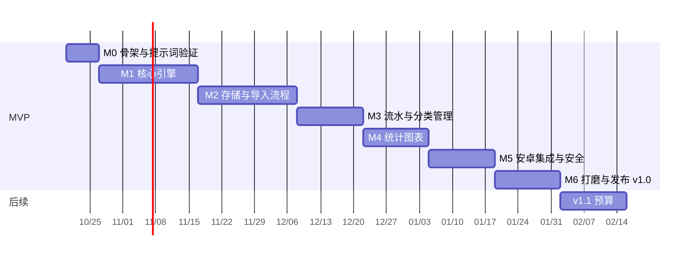

# 06 开发里程碑

工作量按**每周大约 10 小时的业余时间**粗略估计，**仅供参考**：Compose Multiplatform 对你来说是新技术，前两个里程碑可能会慢一些。

**顺序上的考虑**：先做纯逻辑的核心引擎（M1），再做界面。这样最难、最有价值的部分最早能在测试里跑通，面试时也能讲"测试先行"。

（甘特图里的日期只是示意，以你的实际进度为准。）

## 快速路线（2026-10-19 调整，替代下面 M1–M6 的顺序）

目标从"按部就班做完"改为**尽快用上**：先做每天记账离不开的最小闭环，其余功能边用边补。代码全部由 Claude 编写；每个阶段完成后照常逐条验证，并等用户确认。M1–M6 的内容和完成标准保留，作为功能清单和验收依据，只是交付顺序改变。

| 阶段 | 内容 | 完成标准 |
|---|---|---|
| **A：Windows 最小可用版** | M1 的核心引擎（解析、对齐、去重、疑似重复、对账、分类）；M2 的数据库、导入页、预览页、导入历史和撤销；M3 的流水列表（带对账标记）；M4 的简化版本月概览（收支合计和按分类汇总） | 3 份示例 JSON 都按 03 第 5 节的预期处理；重复导入同一份 JSON 新增 0 条；example-3 提示金额"很可能是 £3.20"；`./gradlew :desktopApp:run` 能完成"粘贴 → 预览 → 确认 → 在流水和概览里看到"；CI 是绿的 |
| **B：安卓可用 + 两端同步** | 安卓版本、剪贴板导入、分享菜单；加密备份的导出和导入（M5） | 在 Windows 导出备份 → 安卓导入 → 两边数据一致 |
| **C：边用边补** | 手动记一笔、搜索、分类和规则管理、从修正中学习（M3）；图表、商户排行、趋势（M4）；指纹解锁、双语、MSI 安装包、README（M5–M6）；v1.1 | 按原 M3–M6 的完成标准逐项验收 |

提示词实测（M0）不再卡着开发进度，和阶段 A 同时进行：预览页和余额对账可以兜住 AI 偶尔的抄写错误。

---

## M0：仓库骨架与提示词验证（约 1 周）

**内容**
- 建公开仓库 `snapledger`，MIT 协议。**第一次提交里就包含** `.gitignore`（排除截图、`private/`、`*.slbackup`、`local.properties`、`.env`、密钥库文件）。
- 配置 gitleaks 的 pre-commit 钩子和 CI 任务。
- 用 KMP 向导生成项目，建好 `core`、`data`、`ui`、`androidApp`、`desktopApp` 这几个模块，两个平台都能跑出一个 "Hello" 页面。
- 配置 GitHub Actions：在 Ubuntu 上构建和测试，跑 ktlint 和 detekt。
- 把 `docs/`（这套文档）、`schemas/`、`samples/`（虚构示例）放进仓库；写 ADR-001 到 ADR-003。
- **提示词实测（只在本地进行）**：用 5–10 张真实截图分别测试 ChatGPT 和 Claude，截图的时间段要被一份 PDF 对账单完整覆盖。以**对账单为标准答案**，把 AI 的输出逐条自动比对，把发现的问题改进到提示词里。**真实截图、对账单和输出只放在仓库外的私人文件夹里。**

**完成标准**
- [ ] CI 是绿的；安卓模拟器和 Windows 上都能打开 App。
- [ ] 在一个故意放了假密钥的测试分支上，gitleaks 能拦下提交。
- [ ] 提示词实测：日期、金额、方向的识别准确率 ≥ 98%（按条数算）；"不要去重"这条规则被稳定遵守。没达到的话先改提示词，再进入 M2。

## M1：核心引擎（约 3 周）

**内容**（全部在 `core` 模块，纯 Kotlin）
- 领域模型：`Money`（整数最小单位 + 币种）、`Transaction`、`DailyBalance`、`Category`、`Rule`。
- 解析：从文本提取 JSON、严格反序列化、字段级错误信息。
- 截图间对齐、跨批次按天计数去重、疑似重复检测、日终余额对账（算法见 02 第 4 节）。
- 分类引擎：优先级链、内置规则加载、完整单词匹配、退款分类。
- 测试数据：虚构的场景样本集。

**完成标准**
- [ ] 下面这些场景都有测试并且通过：截图重叠、同一天的相同消费、截图截在一天中间、截图发送顺序颠倒、日期标题被切掉、金额为 null、对账差额提示、重复导入完全相同的 JSON（第二次应该新增 0 条）、退款冲减、个人转账。
- [ ] `core` 模块的测试覆盖率 ≥ 80%（用 Kover 统计）。
- [ ] 3 份示例 JSON 在 CI 里通过 Schema 校验。
- [ ] 写好 ADR-004 到 ADR-007。

## M2：本地存储与导入流程（约 3 周）

**内容**
- 用 SQLDelight 建表（含 `id`、`updated_at`、`deleted_at`），写 Repository 和数据库迁移。
- 导入页：粘贴框、"从剪贴板导入"按钮。
- **预览页**：按颜色分组（新增、已跳过、疑似重复、问题行），可以直接修改，显示对账状态，确认后在一个事务里写入。
- 导入历史和撤销整批。

**完成标准**
- [ ] 在 Windows 上：粘贴 example-1 → 确认 → 数据库里有 4 条记录；再粘贴一次 → 预览显示"新增 0 条、已跳过 4 条"。
- [ ] 粘贴 example-3 → Costa 那一行标红，并提示"金额很可能是 £3.20"；填上金额后对账变成 ✓。
- [ ] 撤销一批导入后，相关的交易和余额记录都恢复原状。

## M3：流水、手动记账与分类管理（约 2 周）

**内容**
- 流水列表：按天分组，显示对账标记 ✓ ⚠ –。
- 搜索和筛选、编辑、软删除、备注。
- 手动记一笔：最多 3 步。
- 分类管理（增删改、隐藏、迁移）、规则管理、从修正中学习、应用到过去的交易。
- 设置里的"复制 AI 提示词"，带上当前分类表。

**完成标准**
- [ ] 手动记一笔从点击 + 到保存不超过 3 步。
- [ ] 改一次分类之后，再导入同一商户的交易会自动套用，并显示 👤 标记。
- [ ] 内置规则在虚构样本上的分类准确率 ≥ 85%（CI 报告）。

## M4：统计图表（约 2 周）

**内容**
- 概览首页：本月支出、收入、结余，以及和上月同期的对比。
- 分类占比环形图（可以下钻到二级分类，再到交易列表）、商户排行前 10、最近 6 或 12 个月的趋势柱状图、切换月份。
- 开始前先调研图表库，选不到合适的就用 Canvas 自己画。

**完成标准**
- [ ] 统计数字和手算结果一致：有专门的测试，覆盖退款冲减、"转账"类型不计入、个人转账计入支出。
- [ ] 2 万条虚构交易时，统计页在 1 秒内打开。
- [ ] 深色和浅色模式下图表都清晰可读。

## M5：安卓集成与安全（约 2 周）

**内容**
- 安卓分享菜单（接收文本）。开始前先实测 ChatGPT 和 Claude 的安卓 App 分享出来的到底是文本还是链接。
- 安卓指纹或设备 PIN 解锁；Windows 可选的 App PIN。
- 加密备份的导出和导入（PBKDF2 + AES-256-GCM），按 `updated_at` 合并。这也是两台设备之间的同步方式。
- 确认安卓 Manifest 里没有 `INTERNET` 权限。

**完成标准**
- [ ] 在 Windows 上导出加密备份 → 在安卓上导入 → 两边数据一致；改错一个字节或输错密码时，导入失败并给出明确的提示。
- [ ] 两台设备各自修改后互相导入，结果符合"较新的修改为准"。
- [ ] 加密模块有单元测试，并通过已知答案测试（用固定的测试向量）。

## M6：打磨与发布 v1.0（约 2 周）

**内容**
- 中英双语资源，跟随系统语言；深色模式；桌面端宽屏分栏。
- 发布流程：打 tag 后自动生成 APK 和 Windows MSI，上传到 GitHub Releases。
- 英文 README：截图（只用虚构数据）、架构图、演示 GIF、"Why I built this"、设计亮点（链接到 ADR）。
- **自己用真实数据跑 2 周**（数据只在本地），收集问题并修复。

**完成标准**
- [ ] 连续 2 周真实使用，没有出现错账，也没有漏掉的重复。
- [ ] 一个从没见过这个项目的人，照着 README 能在 5 分钟内跑起来，并导入示例数据。
- [ ] 仓库里没有任何真实数据：gitleaks 扫描通过，人工检查过所有图片。

---

## 后续版本

| 版本 | 内容 | 完成标准（摘要） |
|---|---|---|
| **v1.1** | 按月、按分类的预算；80% 和 100% 超支提醒；**导入 PDF 对账单**（本地解析，见 ADR-011） | 预算进度在首页可见；提醒在两个平台都能触发；虚构对账单样本 100% 解析正确，合计校验通过；和截图导入的记录对比时，补录、可疑、金额不一致三类都能正确列出 |
| **v1.2** | Pending 自动匹配；周期性账单识别；标签；导入 `.json` 文件；CSV 导出 | Pending 转为已入账后不产生重复；能识别出 3 种以上订阅 |
| **v2.0** | Java + Spring Boot 同步服务（PostgreSQL、JWT、push/pull 接口），是否做端到端加密写成 ADR 决定 | 两台设备离线修改后自动同步、不丢数据；有服务端集成测试（Testcontainers） |
| **v2.1** | App 内调用 LLM API（用户自己提供 API key，存进 Keystore 或凭据管理器；以 JSON Schema 作为 structured output 的约束） | 输出 100% 通过 Schema 校验；不配置 API key 时手动流程不受影响 |
| **v2.x** | AA 冲抵、汇率换算汇总、多账户界面、数据库加密、Windows Hello、iOS（需要 Mac） | 按需求逐项定义 |
